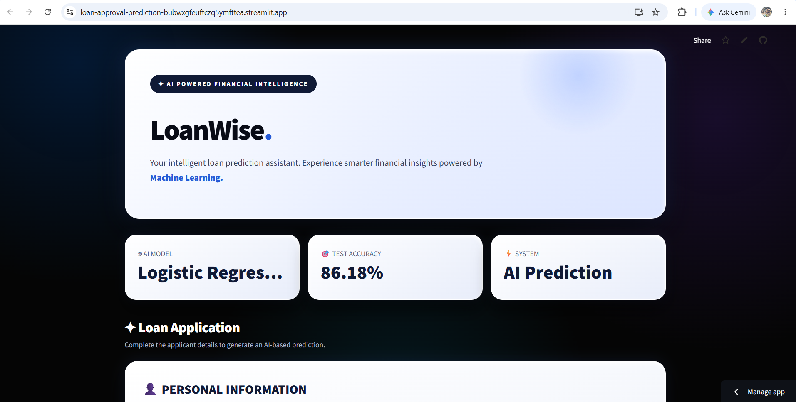
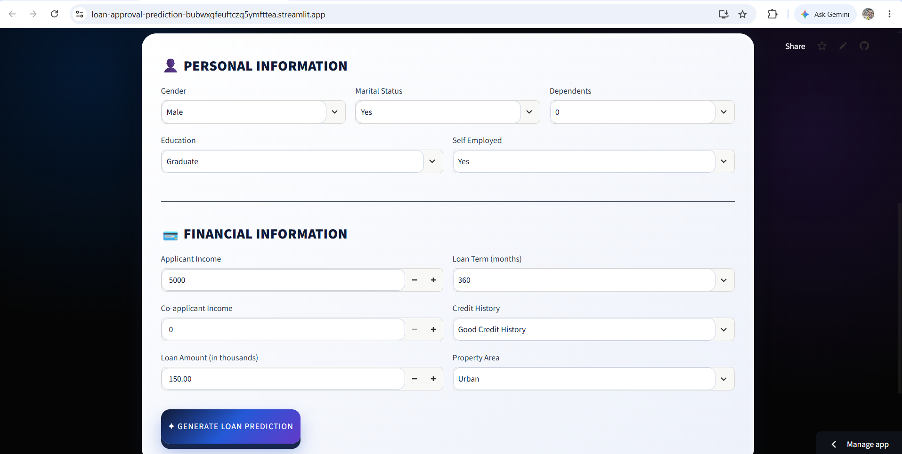
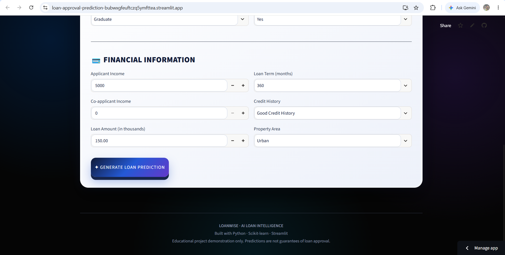

# 🏦 LoanWise – Loan Approval Prediction System

A Machine Learning-based web application that predicts whether a loan application will be **Approved or Rejected** based on applicant information.

Built using Python, Scikit-learn, and Streamlit, LoanWise provides an interactive interface for loan approval prediction.

---

## 📌 Project Overview

Loan approval is an important process in the banking and financial industry. Evaluating loan applications involves analyzing several applicant details, including income, credit history, loan amount, and other financial information.

This project uses Machine Learning classification algorithms to predict loan approval outcomes.

Two Machine Learning algorithms were implemented and evaluated:

- Logistic Regression
- Random Forest Classifier

After comparing their performance, Logistic Regression was selected as the final prediction model.

---

## ✨ Features

- Interactive and user-friendly Streamlit interface.
- Loan approval and rejection prediction.
- Logistic Regression and Random Forest model comparison.
- Data preprocessing and exploratory data analysis.
- Machine Learning model evaluation.
- Instant prediction results.
- Organized application screenshots.

---

## 🛠️ Technologies Used

| Technology | Purpose |
|---|---|
| Python | Programming Language |
| Pandas | Data Manipulation |
| NumPy | Numerical Computing |
| Matplotlib | Data Visualization |
| Seaborn | Statistical Visualization |
| Scikit-learn | Machine Learning |
| Streamlit | Web Application |
| Joblib | Model Serialization |
| Git & GitHub | Version Control |

---

## 🤖 Machine Learning Models

Two classification algorithms were trained and evaluated.

### Model Performance Comparison

| Evaluation Metric | Logistic Regression | Random Forest |
|---|---:|---:|
| Accuracy | 86.18% | 82.11% |
| Precision | 84.00% | 84.62% |
| Recall | 98.82% | 90.59% |
| F1-Score | 90.81% | 87.50% |

### Selected Model: Logistic Regression

Logistic Regression was selected as the final model because it achieved:

- Higher accuracy.
- Higher recall.
- Higher F1-score.

The trained model is saved using Joblib and integrated into the Streamlit application.

---

## 📸 Application Screenshots

### 🏠 Home Page

**Screen 1**



**Screen 2**



**Screen 3**



### ✅ Loan Approval Prediction

**Screen 1**


**Screen 1 – Continuation**


**Screen 2**


**Screen 2 – Continuation**


### ❌ Loan Rejection Prediction

**Screen 1**


**Screen 1 – Continuation**


---

## 📂 Project Structure

```text
Loan-Approval-Prediction/
│
├── dataset/
│   └── loan_data.csv
│
├── models/
│   └── best_model.pkl
│
├── notebooks/
│
├── screenshots/
│   │
│   ├── Home/
│   │   ├── 1.png
│   │   ├── 2.png
│   │   └── 3.png
│   │
│   ├── Loan_Approval/
│   │   ├── 1.png
│   │   ├── 1c.png
│   │   ├── 2.png
│   │   └── 2c.png
│   │
│   └── Loan_Rejection/
│       ├── 1R.png
│       └── 1Rc.png
│
├── app.py
├── train.py
├── eda.py
├── preprocessing.py
├── requirements.txt
└── README.md
```

---

## ⚙️ Installation and Setup

Follow these steps to run the project locally.

### 1. Clone the Repository

```bash
git clone https://github.com/vinayakahosamani787-stack/Loan-Approval-Prediction.git
```

### 2. Navigate to the Project Directory

```bash
cd Loan-Approval-Prediction
```

### 3. Create a Virtual Environment

```bash
python -m venv venv
```

### 4. Activate the Virtual Environment

**Windows:**

```bash
venv\Scripts\activate
```

### 5. Install Dependencies

```bash
pip install -r requirements.txt
```

### 6. Run the Application

```bash
streamlit run app.py
```

The application will open in your default web browser.

---

## 🔄 Model Training

To train the Machine Learning models again, execute:

```bash
python train.py
```

The trained model will be saved in the models directory.

---

## 📊 Evaluation Metrics

The following evaluation metrics were used:

- **Accuracy:** Measures the overall percentage of correct predictions.
- **Precision:** Measures the proportion of positive predictions that are correct.
- **Recall:** Measures the proportion of actual positive cases correctly identified.
- **F1-Score:** Represents the balance between precision and recall.

---

## 🎯 Project Objective

The main objective of LoanWise is to demonstrate how Machine Learning can be applied to financial decision-support systems.

The project covers the complete Machine Learning workflow:

1. Data collection and preprocessing.
2. Exploratory Data Analysis.
3. Model training.
4. Model evaluation and comparison.
5. Final model selection.
6. Streamlit application development.
7. Loan approval prediction.

**Disclaimer:** This project is developed for educational purposes. Predictions should not be considered actual financial or lending decisions.

---

## 👨‍💻 Author

**LoanWise – Loan Approval Prediction System**

GitHub Repository:

[Loan-Approval-Prediction](https://github.com/vinayakahosamani787-stack/Loan-Approval-Prediction)

---

## ⭐ Support

If you find this project useful, please consider giving the repository a ⭐ on GitHub!